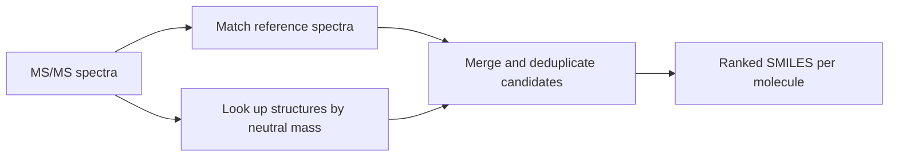

# CASMI

Identify small molecules from tandem mass spectra. This repository builds an independent, reproducible entry for Enveda CASMI 2026. For each molecule, it returns a ranked list of up to 25 candidate structures as SMILES. [Competition](https://www.kaggle.com/competitions/enveda-CASMI26-molecule-id-mass-spectra)

## How it works



The CPU baseline matches fragments against the competition reference spectra. Optional structure catalogs supply candidates by exact mass. The competition scores the rank of the correct structure using **MRR@25** and matches structures by RDKit tautomer-canonical connectivity.

| Evaluation | Result |
| --- | --- |
| Kaggle public leaderboard, library-only submission `58551479` | **0.128 MRR@25** |
| Local Class 2, COCONUT + PubChemLite candidates, ranked by mass error | **0.226 MRR@25**, **927 / 1,003** answers retrieved |
| Same local slice, placing library hits first | **0.118 MRR@25** |

The leaderboard and local slice use different query sets. See the evaluation guide for split construction and scoring. [Evaluation guide](CASMI_EVALUATION.md)

## Run locally

Use Python 3.13. Download `train.parquet` and `test.parquet` from the competition into `data/`. The downloadable test file contains visible examples. Kaggle supplies hidden queries when it scores a submission. [Competition data](https://www.kaggle.com/competitions/enveda-CASMI26-molecule-id-mass-spectra/data)

```sh
python3.13 -m venv .venv
source .venv/bin/activate
python -m pip install -r requirements.txt
python -m unittest -q test_casmi_eval
python casmi_run.py data --output runs/submission.csv
```

Pass `--catalog PATH` for each prepared catalog. The runner checks coverage, canonical uniqueness, and the candidate limit before writing the CSV and `submission.receipt.json`. Build a code-only archive for Kaggle with `python scripts/package_kaggle.py`. [Catalog preparation](CASMI_EVALUATION.md) · [Input provenance](PROVENANCE.md)

## What we’re building next

| Workstream | First deliverable |
| --- | --- |
| Offline baseline | Run the library + catalog pipeline on Kaggle and record its runtime and score. |
| Library confidence | On a fixed candidate pool, test when a strong spectral match should lead. Measure Class 2 gains and Class 1 rank-1 changes. |
| Fingerprint scorer | Train a small model on the fit split and rerank the existing catalog candidates, starting with same-formula isomers. |
| PubChem coverage | Audit membership on the frozen dev IDs. Use the recall gaps to decide how far to expand retrieval. |

The workstreams can run in parallel against the same frozen dev split and evaluator. Compare each change individually before combining them in a submission.

The first library-confidence experiment moved local Class 2 MRR@25 from **0.118 to 0.205** and moved local Class 1 from **0.784 to 0.736**. The cutoff was selected on the fit partition. This experiment is available for local comparison. [Method and commands](CASMI_EVALUATION.md#library-confidence-experiment)
